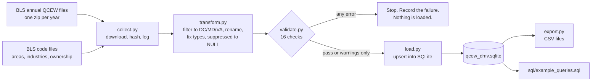

# How the pipeline is put together

## What each file does

| File | Job |
|---|---|
| `config.toml` | The settings: years, states, ownership, tolerances, file locations. |
| `qcew_pipeline/collect.py` | Downloads the annual zips (with retries) and BLS lookup tables, and records each file's size and SHA-256 fingerprint. |
| `qcew_pipeline/transform.py` | Reads each national file in chunks, keeps only the rows I want, renames columns, fixes types, and turns suppressed values into NULL. |
| `qcew_pipeline/validate.py` | Runs the checks. Errors block the load; warnings get recorded. |
| `qcew_pipeline/load.py` | Creates the schema, loads the lookup tables, upserts the data in one transaction, counts new/changed/unchanged rows, and computes a fingerprint of the data. |
| `qcew_pipeline/run.py` | Runs all steps in order with logging and timing, and decides what to do on failure. |
| `qcew_pipeline/export.py` | Writes CSVs from the database. |
| `qcew_pipeline/check_updates.py` | Asks BLS whether a newer annual file exists. |
| `.github/workflows/pipeline.yml` | Runs tests on every push, checks for new data monthly, and can run the pipeline on demand. |

## Decisions worth knowing about

* **Fail the whole run if one year fails.** If a download or a check fails for one year, nothing is loaded. A multi-year table with a silent hole in it would be worse than no new data.
* **Validate before loading.** The database only ever contains data that passed the error-level checks.
* **Upsert, not append.** Re-running can't create duplicates, and changed values are counted so BLS revisions are visible.
* **One main source.** Only QCEW. The state-total rows in the same file are used as an independent cross-check on the county rows.
* **Private sector only.** Government employment is covered and paid differently, so mixing it in would make county comparisons harder to interpret.
