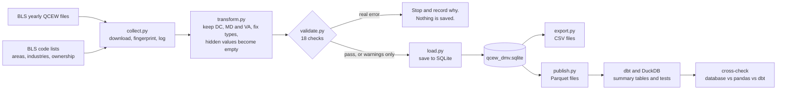

# How the pipeline is put together

## What each file does

| File | What it does |
|---|---|
| `qcew_pipeline/config.toml` | The settings: which years, which region, the limits for the checks, and where files go. It ships inside the package. |
| `qcew_pipeline/regions.toml` | The ready-made regions (DC, Maryland and Virginia, and California): the state codes, how many counties to expect, and the file names for each. It ships inside the package too. |
| `qcew_pipeline/schema.sql` | The layout of the database. It also ships inside the package. |
| `pyproject.toml` | Packaging. It installs the `qcew-run`, `qcew-check-updates`, `qcew-publish` and `qcew-build` commands, and holds the settings for pytest, ruff and mypy. |
| `Dockerfile` | Runs the pipeline in a container. GitHub builds it and starts it on every push to make sure it works. |
| `qcew_pipeline/years.py` | Works out which years to pull. With `years = "auto"` it asks BLS for the newest published year and takes that year plus the four before it. |
| `qcew_pipeline/collect.py` | Downloads the yearly zip files, with retries, and the BLS code lists. It records each file's size and SHA-256 fingerprint. |
| `qcew_pipeline/transform.py` | Reads each national file in pieces, keeps only the rows I want, renames the columns, fixes the types, and turns hidden values into empty ones. |
| `qcew_pipeline/validate.py` | Runs the checks. Errors stop the load. Warnings get written down. |
| `qcew_pipeline/load.py` | Saves the data to SQLite. It copies the new rows into a temporary table and lets SQLite work out what's new, what changed and what BLS dropped, all in one transaction. It also works out a fingerprint of the data. |
| `qcew_pipeline/publish.py` | Writes the database out as Parquet files: one folder per year, the code lists, and a manifest. It builds the new folder next to the old one and then swaps them, so nobody ever reads a half-written set. Needs DuckDB. |
| `qcew_pipeline/analytics.py` | Runs the dbt project in the `analytics` folder on the Parquet files. It sets the paths, passes in the limits from `config.toml`, and turns dbt's result into an exit code. |
| `analytics/` | The dbt project. Staging views clean up the Parquet files, three summary tables are built from them, and tests check the keys, the codes, the hidden-values rule, and the county, state and sector totals. |
| `qcew_pipeline/orchestration.py` | The Dagster layer. Three steps (database, Parquet files, analytics tables) that call the same code as the commands above, two checks on them, one job, a monthly schedule, and a sensor that watches for a new year from BLS. Needs the `orchestration` extras. |
| `qcew_pipeline/run.py` | Runs all the steps in order, with logging and timing, and decides what to do when something fails. |
| `qcew_pipeline/export.py` | Writes CSV files from the database. |
| `qcew_pipeline/check_updates.py` | Asks BLS whether there's a newer yearly file. If it can't reach BLS it exits with code 2, so a broken check never looks like "no news". |
| `.github/workflows/pipeline.yml` | On every push it runs the style, type and unit checks and builds the Docker image. Once a month it checks for new data and opens a GitHub issue if there's a new year. You can also start the pipeline from there by hand. |

## Choices I made, and why

**If one year fails, the whole run fails.** If a download or a check goes wrong for one year, nothing is loaded. A table with a silent hole in the middle is worse than no new data.

**Check first, then load.** The database only ever holds data that passed the checks that can stop a run.

**Two stores, two jobs.** SQLite is where the pipeline keeps its books: the run history, the check results, the rows BLS removed. The Parquet files are what the analytics layer reads. Every Parquet row carries the fingerprint of the file it came from, and the manifest says which state of the database the files were written from, so the two can always be matched up.

**Check the published files a second time.** The pipeline checks the data before it loads it. The dbt tests check it again after it's published, with different code, so a mistake in the publish step, or in either set of checks, can't hide. If the two ever disagree, I want to know why.

**Jobs that belong to no county are counted, not dropped.** BLS keeps a bucket called "unknown or undefined" for jobs it can't place in one county. The state table shows it next to the named counties, and a test checks that the counties plus the bucket add up to the state total. My first dbt table left the bucket out, and the test failed on the real data. That's exactly the kind of mistake the second set of checks is there to find.

**Hidden values never turn into numbers.** In the summary tables, a change from one year to the next, or a sector's share of a county, is left empty when either number is hidden. Nothing is estimated or filled in.

**Warn about drift, don't stop for it.** Two warnings compare each year with the one before: a big jump in the share of hidden values, and a big change in how many rows BLS published. Either one could be a real change at BLS or a problem with the file, and I can't tell which from here. So they're written down and I look into them. The limits are in `config.toml`. They only compare years inside the same run.

**A region is a setting, not code.** The states, the expected county counts and the file names live in `regions.toml`. Switching to California is `--region california`, and no Python changes. Each region gets its own database and its own Parquet and analytics files, so one can never overwrite another. If you put your own states in the settings file, they win over the region.

**One set of downloads for every region.** BLS publishes the annual file for the whole country, so a new region only changes which rows I keep. It doesn't download anything new.

**A rolling window of years.** By default the pipeline pulls the five most recent years, always including the newest one BLS has published, so a new release gets picked up without anyone editing anything. Years that drop out of the window stay in the database. They just stop being refreshed. If you need a frozen, repeatable set, put a fixed list of years in `config.toml`.

**Stage first, then compare inside the database.** The new rows go into a temporary table, and SQLite does the comparing and the saving itself. The stored table is never pulled into pandas, and there's no row-by-row Python loop. On 600,000 made-up rows, about four times the real DMV data, a rerun took 7.6 seconds instead of 22.5, and a typical revision took 9.5 instead of 21.3 (`python evaluation/benchmark_load.py --rows 600000`). The new rows are still held in memory, so there's a ceiling. The next step past it would be loading one year at a time.

**Save, don't append.** Running it again can't create duplicates, and changed values are counted so BLS revisions are easy to see.

**Rows BLS removes are archived.** If BLS stops publishing a row, it moves to `qcew_annual_removed` and the run counts it. I only look at the years, states and sectors in the run, so narrowing `config.toml` never looks like BLS deleting data.

**A load that would remove too much stops.** If more than `max_removed_fraction` (5%) of the stored rows would go, the run fails and changes nothing. A normal revision touches a handful of rows. A big loss means the new file is wrong.

**Dagster calls the code, it doesn't hold it.** Every Dagster step is a few lines around `run_pipeline`, `publish_lake` or `build_analytics`. If Dagster went away tomorrow, nothing about how the data is checked or loaded would change, and the command line would still work.

**Nothing runs on its own until I say so.** The schedule and the sensor start switched off. A pipeline that downloads about 390 MB shouldn't start doing it just because someone opened the Dagster screen.

**One run per new year.** The sensor gives each year it finds a run key, so if it ticks again before the first run has finished, it doesn't start a second one. If it can't reach BLS it fails, for the same reason `qcew-check-updates` exits with code 2.

**One main source.** Only QCEW. The state-total rows in the same file give me an independent check on the county rows.

**Private sector only.** Government jobs are counted and paid differently, so mixing them in would make county comparisons harder to read.
